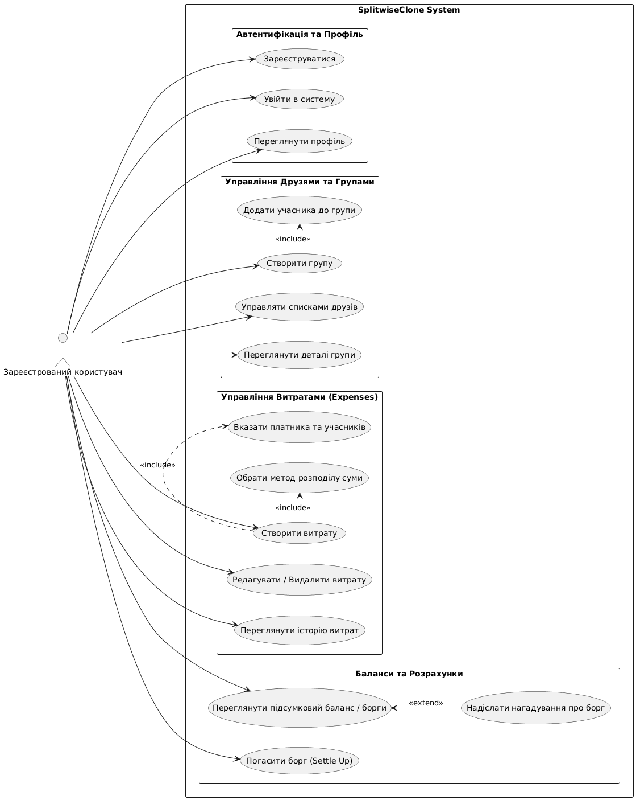

# Splitwise Clone (Backend API)

REST API для клону сервісу **Splitwise**, розроблений на **.NET 10 / EF Core** з дотриманням принципів **Clean Architecture**.

## 🛠 Технологічний стек
- **Framework:** ASP.NET Core Web API (.NET 10)
- **Database:** Microsoft SQL Server
- **ORM:** Entity Framework Core (Code First)
- **Auth:** ASP.NET Core Identity (Identity API endpoints, Bearer-токени)
- **Documentation:** Swagger / OpenAPI

## 🏗 Архітектура

```
Splitwise.Api             → контролери (тільки HTTP), Program.cs, обробка помилок
Splitwise.BusinessLogic   → сервіси з бізнес-логікою, DTO, виняткові ситуації, IApplicationDbContext
Splitwise.Infrastructure  → SplitwiseDbContext (EF Core + Identity), міграції
Splitwise.Domain          → сутності (User, Group, GroupMember, Expense, ExpenseSplit, Settlement)
```

Залежності: `Api → BusinessLogic → Domain`, `Infrastructure → BusinessLogic → Domain`.
Контролери не працюють з `DbContext` напряму — вони викликають сервіси (`IUserService`, `IGroupService`, `IExpenseService`).

### Бізнес-правила (шар BusinessLogic)
- Групи та витрати доступні лише учасникам групи.
- Автор групи автоматично стає її учасником; нових учасників додають за email.
- Сума витрати > 0, не більше 2 знаків після коми; платник — учасник групи.
- Якщо частки не вказано — витрата ділиться порівну (з розподілом копійок); якщо вказано — сума часток має дорівнювати сумі витрати, а всі учасники мають належати до групи.
- Видалити витрату може лише той, хто її оплатив.

## 🔐 Автентифікація та авторизація
Використано [ASP.NET Core Identity API endpoints](https://learn.microsoft.com/en-us/aspnet/core/security/authentication/identity-api-authorization). Користувач (`User`) успадковує `IdentityUser<int>`.

Ендпоінти автентифікації (`/api/auth/...`): `register`, `login`, `refresh`, `manage/info` та ін.
Усі `api/users`, `api/groups`, `api/expenses` захищені атрибутом `[Authorize]`.

Порядок роботи: `POST /api/auth/register` → `POST /api/auth/login` → у заголовку `Authorization: Bearer <accessToken>` (у Swagger — кнопка **Authorize**).

## 🚀 Запуск проєкту

```bash
git clone https://github.com/katerinauhimcuk40-lgtm/SplitwiseClone.git
cd SplitwiseClone

# 1. Створити міграцію (змінилась схема: таблиці Identity)
dotnet ef migrations add InitialIdentity -p Splitwise.Infrastructure -s Splitwise.Api -o Migrations

# 2. Застосувати до бази (LocalDB, рядок підключення у Splitwise.Api/appsettings.json)
dotnet ef database update -p Splitwise.Infrastructure -s Splitwise.Api

# 3. Запустити
dotnet run --project Splitwise.Api
```

> Якщо БД `SplitwiseDb` була створена зі старою схемою — спершу виконайте
> `dotnet ef database drop -p Splitwise.Infrastructure -s Splitwise.Api`.

## Діаграма варіантів використання (Use Case Diagram)


