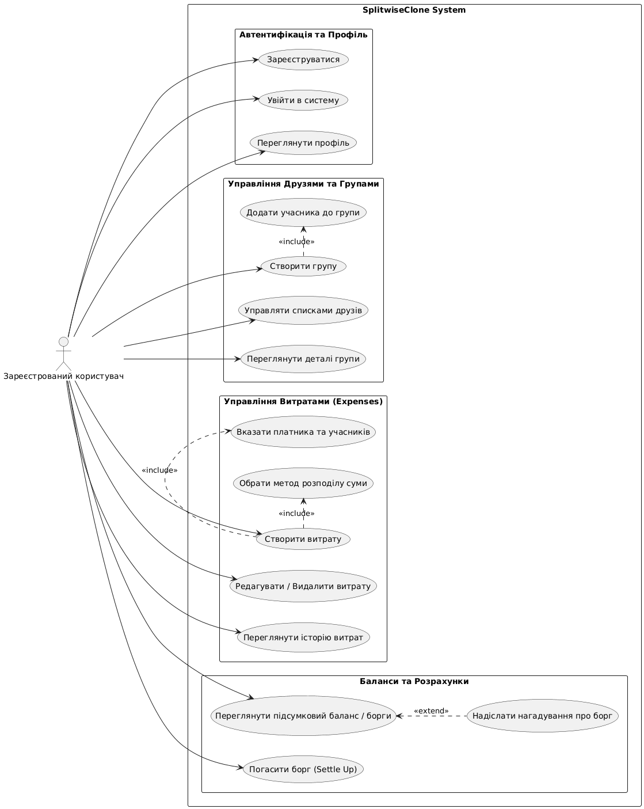

<<<<<<< HEAD
\# Splitwise Clone (Backend API)


Це REST API для клону сервісу \*\*Splitwise\*\*, розроблений на платформах \*\*.NET 9 / EF Core\*\* із дотриманням принципів \*\*Clean Architecture\*\*.


\## 🛠 Технологічний стек

\- \*\*Framework:\*\* .NET 9 Web API

\- \*\*Database:\*\* Microsoft SQL Server

\- \*\*ORM:\*\* Entity Framework Core (Code First)

\- \*\*Architecture:\*\* Clean Architecture (`Domain`, `Infrastructure`, `Api`)

\- \*\*Documentation:\*\* Swagger / OpenAPI


\## 📐 Доменні моделі (Domain Layer)

Проєкт містить структуру моделей для обліку спільних витрат:

\- \*\*User\*\* — користувач системи.

\- \*\*Group\*\* — група для спільного розрахунку витрат.

\- \*\*GroupMember\*\* — зв'язок користувачів із групами (багато до багатьох).

\- \*\*Expense\*\* — створення та облік витрат у межах групи.

\- \*\*ExpenseSplit\*\* — розподіл частки витрати між учасниками.

\- \*\*Settlement\*\* — фіксація взаєморозрахунків (погашення боргу) між користувачами.


\## 🚀 Запуск проєкту


\### 1. Клонування репозиторію

```bash

git clone 

cd SplitwiseClone

## Діаграма варіантів використання (Use Case Diagram)


=======
# Splitwise Clone (Backend API)

Це REST API для клону сервісу **Splitwise**, розроблений на платформах **.NET 9 / EF Core** із дотриманням принципів **Clean Architecture**.

## 🛠 Технологічний стек
- **Framework:** .NET 9 Web API
- **Database:** Microsoft SQL Server
- **ORM:** Entity Framework Core (Code First)
- **Architecture:** Clean Architecture (`Domain`, `Infrastructure`, `Api`)
- **Documentation:** Swagger / OpenAPI

## 📐 Доменні моделі (Domain Layer)
Проєкт містить структуру моделей для обліку спільних витрат:
- **User** — користувач системи.
- **Group** — група для спільного розрахунку витрат.
- **GroupMember** — зв'язок користувачів із групами (багато до багатьох).
- **Expense** — створення та облік витрат у межах групи.
- **ExpenseSplit** — розподіл частки витрати між учасниками.
- **Settlement** — фіксація взаєморозрахунків (погашення боргу) між користувачами.

## 🚀 Запуск проєкту

### 1. Клонування репозиторію
```bash
git clone https://github.com/katerinauhimcuk40-lgtm/SplitwiseClone.git
cd SplitwiseClone
>>>>>>> 1c5d7e4ff31ec6201003f622953561cdde466e3e
## Діаграма варіантів використання (Use Case Diagram)


