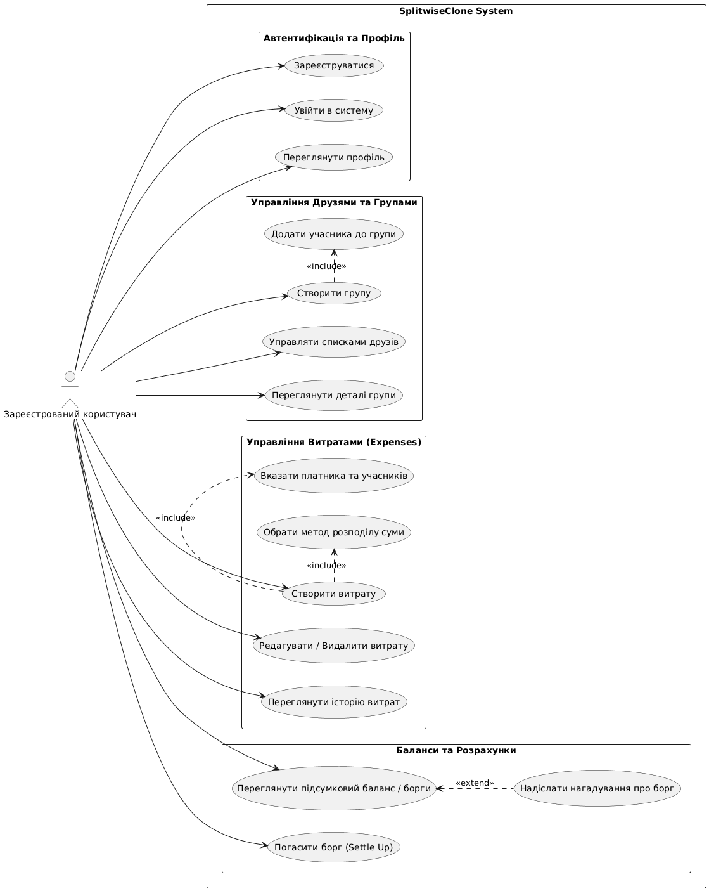

# Splitwise Clone (Backend API)


REST API для клону сервісу **Splitwise**, розроблений на **.NET 10 / EF Core** з дотриманням принципів **Clean Architecture**.

## 🛠 Технологічний стек
- **Framework:** ASP.NET Core Web API (.NET 10)
- **Database:** Microsoft SQL Server
- **ORM:** Entity Framework Core (Code First)
- **Auth:** ASP.NET Core Identity (Identity API endpoints, Bearer-токени)
- **Validation:** FluentValidation 12
- **Tests:** xUnit, EF Core InMemory, coverlet
- **CI:** GitHub Actions
- **Documentation:** Swagger / OpenAPI

## 🏗 Архітектура

```
Splitwise.Api             → контролери (тільки HTTP), Program.cs, обробка помилок
Splitwise.BusinessLogic   → сервіси з бізнес-логікою, DTO, виняткові ситуації, IApplicationDbContext
Splitwise.Infrastructure  → SplitwiseDbContext (EF Core + Identity), міграції
Splitwise.Domain          → сутності (User, Group, GroupMember, Expense, ExpenseSplit, Settlement)
Splitwise.Tests           → unit-тести (xUnit)
```

Залежності: `Api → BusinessLogic → Domain`, `Infrastructure → BusinessLogic → Domain`.
Контролери не працюють з `DbContext` напряму — вони викликають сервіси (`IUserService`, `IGroupService`, `IExpenseService`).

### Бізнес-правила (шар BusinessLogic)
- Групи та витрати доступні лише учасникам групи.
- Автор групи автоматично стає її учасником; нових учасників додають за email.
- Платник і всі учасники розподілу мають бути учасниками групи.
- Якщо частки не вказано — витрата ділиться порівну (з розподілом копійок).
- Видалити витрату може лише той, хто її оплатив.

## 🔐 Автентифікація та авторизація
Використано [ASP.NET Core Identity API endpoints](https://learn.microsoft.com/en-us/aspnet/core/security/authentication/identity-api-authorization). Користувач (`User`) успадковує `IdentityUser<int>`.

Ендпоінти автентифікації (`/api/auth/...`): `register`, `login`, `refresh`, `manage/info` та ін.
Усі `api/users`, `api/groups`, `api/expenses` захищені атрибутом `[Authorize]`.

Порядок роботи: `POST /api/auth/register` → `POST /api/auth/login` → у заголовку `Authorization: Bearer <accessToken>` (у Swagger — кнопка **Authorize**).

## ✅ Валідація вхідних DTO (FluentValidation)
Валідатори лежать у `Splitwise.BusinessLogic/Validators` (`CreateGroupRequestValidator`, `AddGroupMemberRequestValidator`, `CreateExpenseRequestValidator`, `ExpenseSplitRequestValidator`) і реєструються через `AddValidatorsFromAssemblyContaining`.

Пакет `FluentValidation.AspNetCore` застарів, тому інтеграція зроблена власним `ValidationFilter` (`Splitwise.Api/Filters`): перед виконанням екшена він знаходить `IValidator<T>` для кожного аргумента і, якщо є помилки, кидає `RequestValidationException`.

## ⚠️ Кастомні винятки та глобальна обробка помилок
Ієрархія (`Splitwise.BusinessLogic/Exceptions`):

```
AppException (ErrorCode)
├── NotFoundException (404)        → UserNotFoundException, GroupNotFoundException, ExpenseNotFoundException
├── ForbiddenException (403)       → NotGroupMemberException, ExpenseDeletionNotAllowedException
├── ConflictException (409)        → UserAlreadyInGroupException
├── BusinessRuleException (400)    → InvalidExpenseException
└── RequestValidationException (400, помилки по полях)
```

`AppExceptionHandler` перетворює їх на `ProblemDetails` (RFC 9457) з полем `code`, а `GlobalExceptionHandler` логує будь-які інші винятки й повертає безпечну відповідь 500. Обидва підключені через `IExceptionHandler` + `app.UseExceptionHandler()`.

Приклад відповіді на невалідний запит (`400`):

```json
{
  "title": "Помилка валідації",
  "status": 400,
  "detail": "Один або кілька параметрів запиту не пройшли валідацію.",
  "errors": {
    "Description": ["Опис витрати обов'язковий."],
    "Amount": ["Сума витрати має бути більшою за нуль."]
  },
  "code": "RequestValidation"
}
```

## 🧪 Unit-тести
Проєкт `Splitwise.Tests` (xUnit). Сервіси тестуються на `InMemory`-базі EF Core, окрема ізольована база на кожен тест.

| Що покрито | Файли |
|---|---|
| Бізнес-логіка сервісів (групи, витрати, користувачі) | `Services/*ServiceTests.cs` |
| FluentValidation-валідатори DTO | `Validators/*Tests.cs` |
| Глобальні обробники помилок, ієрархія винятків | `Api/AppExceptionHandlerTests.cs` |
| Фільтр валідації вхідних DTO | `Api/ValidationFilterTests.cs` |
| Отримання Id користувача з токена | `Api/ClaimsPrincipalExtensionsTests.cs` |

Запуск локально:

```bash
dotnet test
# з покриттям коду
dotnet test --collect:"XPlat Code Coverage"
```

## 🔄 CI (GitHub Actions)
Workflow `.github/workflows/ci.yml` запускається при кожному `push` і `pull request` у `main` (а також вручну): відновлює залежності, збирає solution у Release, запускає всі тести, рахує покриття і зберігає звіти (`.trx`, `coverage.cobertura.xml`) як artifact `test-results`. Підсумок покриття видно на сторінці запуску (Summary).

## 🚀 Запуск проєкту

```bash
git clone https://github.com/katerinauhimcuk40-lgtm/SplitwiseClone.git
cd SplitwiseClone

# 1. Створити міграцію (змінилась схема: таблиці Identity)
dotnet ef migrations add InitialIdentity -p Splitwise.Infrastructure -s Splitwise.Api -o Migrations

# 2. Застосувати до бази (LocalDB, рядок підключення у Splitwise.Api/appsettings.json)
dotnet ef database update -p Splitwise.Infrastructure -s Splitwise.Api

# 3. Запустити
dotnet run --project Splitwise.Api
```

> Якщо БД `SplitwiseDb` була створена зі старою схемою — спершу виконайте
> `dotnet ef database drop -p Splitwise.Infrastructure -s Splitwise.Api`.

## Діаграма варіантів використання (Use Case Diagram)


